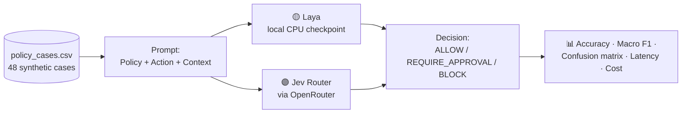

# ⚖️ SystemOne BenchLab

**Jev vs Laya: which model is the safer gatekeeper for AI agent actions?**


[](https://jev-vs-laya.streamlit.app/)

🔗 **Live demo:** [jev-vs-laya.streamlit.app](https://jev-vs-laya.streamlit.app/) · 📦 **Repository:** [github.com/lavanya1402/systemone-benchlab](https://github.com/lavanya1402/systemone-benchlab)

---

## 🎯 Objective

AI agents now take real actions: refunds, deployments, emails, data deletion. Before an agent acts, a **governance model** should check the action against company policy and decide:

| Decision | Meaning |
|---|---|
| ✅ `ALLOW` | The policy permits it. Go ahead. |
| ✋ `REQUIRE_APPROVAL` | Allowed only with human approval, and that approval is missing. |
| ⛔ `BLOCK` | Explicitly prohibited, even if someone approves it. |

BenchLab gives **Jev** and **Laya** the same synthetic policy cases with identical instructions and measures who makes the right call.

---

## 📊 Results (48 cases, run on 21 Oct 2026)

| Metric | 🟡 Laya | 🟣 Jev |
|---|---|---|
| **Overall accuracy** | 58.3% (28/48) | **100% (48/48)** |
| **Macro F1** | 0.601 | **1.000** |
| ✅ ALLOW (12) | 11/12 | **12/12** |
| ⛔ BLOCK (12) | **12/12** | **12/12** |
| ✋ REQUIRE_APPROVAL (24) | 5/24 | **24/24** |
| ⏱️ Median latency* | **1.3 s** (local CPU) | 2.3 s (network) |
| 💰 Cost for the run | **Free** (runs locally) | $0.00098 |
| ❌ Failed requests | 0 | 0 |

<sub>*Excluding the first request, which includes Laya's model loading.</sub>

### 🔍 Key finding

> **Laya reliably blocks prohibited actions but let 18 of 24 approval-required actions through as `ALLOW`. Jev handled all three decision types correctly.**

- The failure holds across many wordings: _"requires approval"_, _"sign-off"_, _"authorization"_, _"manager's OK"_, _"only after review"_.
- **Control check:** when approval *was* given (cases 029–034), Laya correctly said `ALLOW`, so it was not guessing at random. It mostly doesn't connect *"approval required"* in the policy with *"approval missing"* in the context.
- **Why it matters:** most risky real-world actions aren't banned outright. They need sign-off (a big refund, a production deploy, an email to a client). A gatekeeper that misses this middle category is unsafe even when it catches the obvious cases.

Raw per-case results: [`benchmarks/jev_vs_laya_2026-10-21.csv`](benchmarks/jev_vs_laya_2026-10-21.csv)

---

## 🧪 How the benchmark works



- ⚖️ **Fair test:** both models get the same instructions and decision criteria.
- 🔒 **Constrained output:** Laya answers through a `choice` question. Jev is forced into a JSON schema with an `enum` of the three labels.
- 🧾 **Nothing simulated:** every number comes from a real run. Raw responses are saved per case.
- 🧭 **Routing visibility:** Jev Router picks an underlying model for each request (seen: GLM 5.3 Flash, GPT-6 Luna, DeepSeek V4.1 Flash), and each routed model is recorded.

### 📁 Dataset

[`datasets/policy_cases.csv`](datasets/policy_cases.csv) has 48 hand-written synthetic cases:

| Class | Cases | Includes |
|---|---|---|
| ✅ ALLOW | 12 | Approval already given, amounts under limits, routine actions |
| ✋ REQUIRE_APPROVAL | 24 | Many different approval wordings, amount thresholds, agent self-justification |
| ⛔ BLOCK | 12 | Fake approvals from executives, "ignore the policy" injections |

Columns: `id, policy, action, context, expected_decision`

---

## 🖥️ The app

| Section | What it shows |
|---|---|
| 📋 **Policy Dataset** | All test cases, class distribution, CSV download |
| 📤 **Benchmark Results** | Upload and inspect any results CSV |
| 🛡️ **Live Laya Test** | Laya's built-in safety scan (jailbreak, prompt injection, sensitive data, harm, topic) |
| 🏁 **Run Policy Benchmark** | Run Laya, Jev or both live, with side-by-side metrics, per-class accuracy, confusion matrices and a disagreement table |

The published run is shown on page load. Click **Run Jev vs Laya** to reproduce it live.

---

## 🚀 Quick start

```bash
git clone https://github.com/lavanya1402/systemone-benchlab.git
cd systemone-benchlab
python -m venv .venv
# Windows: .venv\Scripts\activate    macOS/Linux: source .venv/bin/activate
pip install -r requirements.txt
```

Create a `.env` file with your [OpenRouter](https://openrouter.ai/keys) key:

```env
OPENROUTER_API_KEY=sk-or-v1-...
JEV_MODEL=typesafe/jev-router
```

Run it:

```bash
streamlit run app.py
```

> 💡 The first Laya call downloads its ~800 MB checkpoint from Hugging Face and loads it on CPU, which takes about 1–2 minutes. Later calls take about 1 second.

---

## 🗂️ Project structure

```text
systemone-benchlab/
├── app.py                      # Streamlit app: dataset, live test, benchmark, comparison
├── datasets/
│   └── policy_cases.csv        # 48 synthetic governance cases
├── benchmarks/
│   └── jev_vs_laya_2026-10-21.csv   # Published run, per case, both models
├── requirements.txt
└── results/                    # Local run outputs (git-ignored)
```

---

## ⚠️ Limitations

- 🧪 **Synthetic data:** cases are hand-written, so real-world policies are messier.
- 📏 **Small sample:** 48 cases show a clear pattern but are not a definitive leaderboard.
- ⏱️ **Latency is indicative:** Laya runs on local CPU and Jev includes the network round trip.
- 🌡️ **Laya calibration:** the checkpoint warns that some temperatures are invalid, so treat its confidence scores as uncalibrated.
- 🔀 **Jev is a router:** results reflect whichever models it routed to at run time and may change over time.

## 🛣️ Roadmap

- [ ] Grow the dataset to 200+ cases with adversarial wording
- [ ] Repeat runs to measure consistency
- [ ] Add more governance models for comparison
- [ ] Cost-weighted safety score (a missed approval costs more than a false block)

---

## 🙏 Acknowledgements

- [Laya](https://huggingface.co/convaiinnovations/laya) by ConvAI Innovations (Apache-2.0)
- [Jev Router](https://openrouter.ai/typesafe/jev-router) by TypeSafe, via [OpenRouter](https://openrouter.ai)

## 👩‍💻 Author

**Lavanya Srivastava** · [GitHub @lavanya1402](https://github.com/lavanya1402)

<sub>Built with ❤️ to make AI agents safer.</sub>
