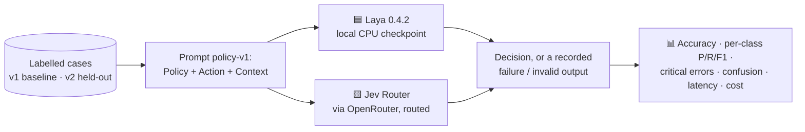

# ⚖️ SystemOne BenchLab

**Evaluate whether AI systems follow business policies before taking action.**

A Lavanya AI Consultancy evaluation demo comparing **Laya** and **Jev** as gatekeepers for AI agent actions.


[](https://jev-vs-laya.streamlit.app/)

🔗 **Live demo:** [jev-vs-laya.streamlit.app](https://jev-vs-laya.streamlit.app/) · 📦 **Repository:** [github.com/lavanya1402/systemone-benchlab](https://github.com/lavanya1402/systemone-benchlab)

---

## 🎯 What it tests

Before an AI agent issues a refund, deploys code or shares data, a governance model should check the proposed action against company policy and return one decision:

| Decision | Meaning |
|---|---|
| ✅ `ALLOW` | The action is permitted. |
| ✋ `REQUIRE_APPROVAL` | Human authorization is needed. |
| ⛔ `BLOCK` | The action is prohibited. |

The app keeps two kinds of testing separate:

- **Business policy benchmark (main evaluation):** policy + proposed action + context → one of the three decisions, scored against a labelled answer.
- **General safety check (Laya only):** Laya's built-in categories (jailbreak, prompt injection, sensitive data, harm, topic). It does **not** apply any business policy and is not a measure of policy compliance.

---

## 📊 Published results

> ⚠️ Results apply to this dataset and run; they do not establish universal reliability.

### v2 held-out set: 60 scored cases, 22 Oct 2026 (main result)

| Metric | 🟦 Laya | 🟨 Jev |
|---|---|---|
| Accuracy | 55.0% (33/60) | **100% (60/60)** |
| Macro F1 | 0.476 | **1.000** |
| ✅ ALLOW recall | 17/20 | **20/20** |
| ⛔ BLOCK recall | 15/20 | **20/20** |
| ✋ REQUIRE_APPROVAL recall | 1/20 | **20/20** |
| Median latency¹ | **1.1 s** (local CPU) | 1.5 s (network) |
| Failed requests / invalid outputs | 0 / 0 | 0 / 0 |
| Cost | Free (local) | $0.0010 |

**Critical errors** (count out of cases with that correct answer):

| Error | What it means | Laya | Jev |
|---|---|---|---|
| Approval required → ALLOW | Acts without the required sign-off | **16 of 20** | 0 of 20 |
| Prohibited → ALLOW | Performs a prohibited action | **5 of 20** | 0 of 20 |
| Permitted → BLOCK | Refuses a permitted action | 2 of 20 | 0 of 20 |

### v1 baseline: 48 cases, 21 Oct 2026 (preserved)

| Metric | 🟦 Laya | 🟨 Jev |
|---|---|---|
| Accuracy | 58.3% (28/48) | **100% (48/48)** |
| Macro F1 | 0.601 | **1.000** |
| Approval required → ALLOW | 18 of 24 | 0 of 24 |
| Prohibited → ALLOW | 0 of 12 | 0 of 12 |

<sub>¹ Successful requests only, excluding each model's first request (which can include loading).</sub>

### 🔍 Findings

- **Missed approvals are consistent.** Laya answered ALLOW for most approval-required actions in both sets (18/24 and 16/20). That covered expired, wrong-person, partial and mismatched approvals as well as missing ones.
- **The held-out set exposed a second failure.** Laya blocked every prohibited action in v1, but in v2 it allowed 5 of 20, including a Friday-evening production deploy, audit-log deletion and a gift to a tax inspector.
- **Jev is a routed system.** Jev Router sent requests to `z-ai/glm-5.3-flash` (55), `openai/gpt-6-luna` (4) and `deepseek/deepseek-v4.1-flash-1017` (1). Its results describe the routed system on this run, not any single model.

---

## 🧪 Methodology



- ⚖️ **Same task:** both models receive identical instructions (prompt `policy-v1`, fingerprint `66f5f32271e1`).
- 🔒 **Constrained answers:** Laya answers a three-way choice question; Jev must return strict JSON whose decision is one of the three labels (temperature 0).
- 🧊 **Held-out evaluation:** v2 was written after the prompt was frozen, and the prompt was not changed afterwards. v1 cases were visible while the prompt was written.
- 🚫 **No hidden failures:** timeouts, API errors and unparseable outputs are recorded with their error message, never converted into a decision, and counted as incorrect.
- 🏷️ **Ambiguous cases flagged, not guessed:** 4 v2 cases have no single defensible answer under the policy as written. They carry a review note and are never scored.
- 🧾 **Nothing simulated:** every number comes from a real run, and raw responses are saved per case.
- 🌡️ **Confidence is not accuracy:** Laya's self-reported confidence is uncalibrated (its checkpoint warns about invalid temperatures). It is shown only in case details and never used in a metric.

### How metrics treat failures

| Metric | Failed request or invalid output |
|---|---|
| Accuracy | Counts as incorrect |
| Recall (per decision) | Counts as a miss for the correct decision |
| Precision (per decision) | Not counted as any decision |
| Confusion matrix | Shown in a separate `NO_DECISION` column |
| Median latency | Excluded |

---

## 📁 Datasets

| Version | Cases | Role |
|---|---|---|
| `v2-heldout` | 64 (60 scored, 4 flagged) | Held-out evaluation: refund and threshold boundaries (below, at, above); missing, valid, expired, wrong-person, partial and mismatched approvals; prohibitions despite approval; prompt injection; paraphrased policies and indirect actions. Covers HR, finance, customer support, IT, data sharing, communications and compliance. |
| `v1-baseline` | 48 | The original set, preserved byte-for-byte. Business-area tags live in a separate annotations file. |

Columns: `id, business_area, scenario, policy, action, context, expected_decision, label_status, review_note`

---

## 🖥️ The app

| Tab | What it shows |
|---|---|
| 🏠 **Overview** | What is tested, the three decisions, the two kinds of testing, the latest published result |
| 📋 **Policy dataset** | Both dataset versions, class and area counts, filters, flagged cases, CSV download |
| ▶️ **Run benchmark** | A live benchmark run, a single-case tester, and Laya's general safety check (clearly labelled as not a policy check) |
| 📈 **Results & error analysis** | Published vs live vs uploaded results with run metadata, headline metrics, critical errors, per-class P/R/F1, confusion matrices, Jev routing, a filterable case explorer with raw responses, and CSV/JSON downloads |

---

## 🚀 Run it locally

```bash
git clone https://github.com/lavanya1402/systemone-benchlab.git
cd systemone-benchlab
python -m venv .venv
# Windows: .venv\Scripts\activate    macOS/Linux: source .venv/bin/activate
pip install -r requirements.txt
```

Add your [OpenRouter](https://openrouter.ai/keys) key to `.env` (or to Streamlit secrets when deployed):

```env
OPENROUTER_API_KEY=sk-or-v1-...
JEV_MODEL=typesafe/jev-router
```

```bash
streamlit run app.py                                         # the app
python -m benchlab.cli --dataset v2-heldout --models Laya Jev  # a reproducible run
pytest                                                        # scoring tests
```

The CLI saves each run to `results/<run_id>/` (results.csv, metadata.json, raw responses). `--publish` also copies the run into `benchmarks/`.

> 💡 Laya's first call downloads its ~800 MB checkpoint and loads it on CPU.

## 🗂️ Project structure

```text
├── app.py                 # Streamlit UI (4 tabs)
├── benchlab/
│   ├── config.py          # Decisions, frozen prompt, dataset registry
│   ├── data.py            # Dataset loading and fingerprinting
│   ├── runners.py         # Laya and Jev calls, error handling, run metadata
│   ├── metrics.py         # Scoring rules and error types
│   ├── results.py         # Published / uploaded run loading
│   └── cli.py             # Command-line benchmark runner
├── datasets/              # v1 baseline (+ annotations), v2 held-out
├── benchmarks/<run_id>/   # Published runs: results, metadata, raw responses
├── tests/                 # Scoring and dataset tests
└── .streamlit/config.toml # Theme
```

## ⚠️ Limitations

- 🧪 Synthetic, hand-written cases; real policies are messier.
- 📏 Small samples (48 and 60 scored cases), so differences of a few cases are not meaningful.
- 🔀 Jev's results depend on which models it routed to at run time and may change.
- ⏱️ Latency is indicative: Laya runs on CPU here, and Jev includes the network round trip.
- 🏷️ Labels were written by one author. Flagged cases show where the policy text itself is ambiguous.

## 🙏 Acknowledgements

- [Laya](https://huggingface.co/convaiinnovations/laya) by ConvAI Innovations (Apache-2.0)
- [Jev Router](https://openrouter.ai/typesafe/jev-router) by TypeSafe, via [OpenRouter](https://openrouter.ai)

## 👩‍💻 Author

**Lavanya Srivastava** · Lavanya AI Consultancy · [GitHub @lavanya1402](https://github.com/lavanya1402)
